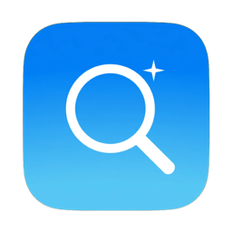

<div align="center">



# Chaja (차자)

**맥 전체에서 원하는 파일을, 조건을 겹겹이 쌓아 바로 찾는 macOS 네이티브 앱**

이름 · 확장자 · 종류 · 크기 · 날짜 · 태그 · 다운로드 출처를 **모두 만족하는(AND)** 파일만 골라냅니다.<br>
검색 문법을 몰라도 칩과 스위치만 누르면 됩니다.


</div>

---

## 왜 Chaja인가요?

Finder 검색은 조건을 하나씩 추가하기 번거롭고, `mdfind`는 문법을 외워야 합니다.
Chaja는 macOS가 이미 만들어 둔 **Spotlight 인덱스를 직접 조회**하기 때문에 디스크를 뒤지지 않고도 맥 전체를 순식간에 찾습니다.

| 이 맥(M2, 24GB)에서 잰 실제 속도 | 결과 수 | 걸린 시간 |
|---|---:|---:|
| 맥 전체에서 이름에 "정산"이 들어간 파일 | 5 | **0.19초** |
| PDF 중 최근 30일 이내, 10MB 미만 | 22 | **0.58초** |
| 홈 폴더의 코드 파일 (상한 1만 개까지) | 10,000 | **1.7초** (첫 결과 0.08초) |

> 결과는 찾는 즉시 화면에 흘러나오고(스트리밍), 너무 넓은 검색은 설정한 개수에서 멈춰 앱이 느려지지 않습니다.

---

## 주요 기능

### 🔍 조건 검색
- **이름 / 이름 + 내용**: 여러 단어는 모두 들어 있어야 일치. PDF·Office·텍스트 파일은 본문 단어까지 찾습니다
- **확장자**: `.pdf`, `.jpg/.png`, `.docx/.hwp` 같은 묶음 칩과 직접 입력(`sketch, fig`)
- **파일 종류**: 문서 · 이미지 · 동영상 · 오디오 · 코드 · 압축 · 폴더
- **크기**: 최소~최대 MB 입력, `~10MB` · `1GB+` 같은 빠른 선택
- **날짜**: 수정일/생성일 기준으로 오늘 · 7일 · 30일 · 1년 · 직접 지정
- **Finder 태그**: 색상 태그와 사용 중인 태그를 칩으로 표시 (여러 개는 "하나라도")
- **다운로드 출처**: `google`, `kakao`처럼 사이트 주소 일부로 받은 파일 찾기
- **위치**: 맥 전체 · 홈 · 데스크탑 · 다운로드 · 문서 · 원하는 폴더

### ⚡️ 빠르고 정확하게
- 조건을 바꾸면 **잠시 뒤 자동으로 검색** (Enter · 찾기 버튼으로 즉시 실행도 가능)
- 한글 파일명의 자모 분리(NFC/NFD) 차이를 무시하고 찾습니다
- **숨김 파일 · 앱 패키지 내부**처럼 Spotlight가 색인하지 않는 곳은 디스크를 직접 훑어 함께 찾습니다
- **제외 폴더**: `node_modules`, `.git`, `DerivedData`, `~/Library/Caches` 등을 결과에서 빼기

### 🗂 결과 다루기
- 리스트(정렬 가능한 표) / 그리드(썸네일) 보기
- 스페이스바로 **Quick Look 훑어보기**, 더블클릭으로 열기, 끌어서 다른 앱에 놓기
- 오른쪽 **미리보기 패널**: 썸네일, 위치·크기·날짜, 태그, 다운로드 출처
- Finder에서 보기 · 경로 복사 · 휴지통으로 이동 (여러 개 한꺼번에)

### 🧭 손에 붙는 편의 기능
- **전역 단축키 `⌃⌥F`**: 어느 앱에서든 Chaja를 불러오고 검색창에 바로 입력. 다시 누르면 숨김
- **검색 저장**: 자주 쓰는 조건에 이름을 붙여 두고 `⌘1`~`⌘9`로 바로 실행
- **최근 검색 10개**: 실제로 써먹은 검색만 기록
- **설정**: 단축키 변경, 로그인 시 자동 실행, 결과 최대 개수, 기본 검색 위치, 제외 폴더 편집

---

## 키보드 단축키

| 단축키 | 동작 |
|---|---|
| `⌃⌥F` | (어느 앱에서든) Chaja 불러오기 / 숨기기 — 설정에서 변경 가능 |
| `⌘F` | 검색창으로 이동 |
| `↩` / `⌘↩` | 지금 검색 |
| `Space` / `⌘Y` | 훑어보기 (Quick Look) |
| `⌘O` | 열기 |
| `⌘R` | Finder에서 보기 |
| `⌥⌘C` | 경로 복사 |
| `⌘⌫` | 휴지통으로 이동 |
| `⌘S` | 현재 검색 저장 |
| `⌘1` ~ `⌘9` | 저장된 검색 실행 |
| `⇧⌘K` | 필터 초기화 |
| `⌘,` | 설정 |

---

## 설치

> 개인용 앱이라 App Store나 Apple 공증 없이, 빌드한 `Chaja.app`을 복사해서 설치합니다.

1. `Chaja.app`을 **응용 프로그램** 폴더로 복사합니다 (AirDrop · USB 등).
2. 처음 열 때 "확인되지 않은 개발자" 경고가 나오면
   **시스템 설정 → 개인정보 보호 및 보안 → "그래도 열기"** 를 누릅니다.
   그래도 열리지 않으면 터미널에서:
   ```bash
   xattr -dr com.apple.quarantine /Applications/Chaja.app
   ```
3. 숨김 파일이나 보호된 폴더까지 찾으려면
   **시스템 설정 → 개인정보 보호 및 보안 → 전체 디스크 접근 권한** 에서 Chaja를 켭니다.
   (Spotlight 인덱스 검색만 쓴다면 없어도 됩니다.)

**요구 사항**: macOS 26 이상, Apple Silicon 맥

---

## 직접 빌드하기

```bash
brew install xcodegen          # 처음 한 번
xcodegen generate              # project.yml → Chaja.xcodeproj
xcodebuild -project Chaja.xcodeproj -scheme Chaja -configuration Debug \
           -derivedDataPath build/DerivedData build
open build/DerivedData/Build/Products/Debug/Chaja.app
```

- `Chaja.xcodeproj`는 저장소에 넣지 않습니다. 새 Swift 파일을 추가했다면 `xcodegen generate`를 다시 실행하세요.
- 서명은 키체인의 자체 서명 인증서 **`Chaja Self-Signed`** 를 씁니다. 같은 인증서로 서명하면 다시 빌드해도 전체 디스크 접근 권한이 유지됩니다.
  인증서가 없는 맥에서는 임시 서명으로 빌드할 수 있습니다:
  ```bash
  xcodebuild ... CODE_SIGN_IDENTITY=- build
  ```

### 테스트

```bash
xcodebuild test -project Chaja.xcodeproj -scheme Chaja -derivedDataPath build/DerivedData
```

Swift Testing 36개: 쿼리 생성, 한글 이름 매칭, 직접 스캔(숨김·패키지·제외·태그·출처), 저장 형식 하위 호환, 검색 기록,
그리고 **앱의 검색 결과 수가 같은 조건의 `mdfind` 결과와 일치하는지** 실제 Spotlight로 비교하는 통합 테스트가 포함되어 있습니다.

---

## 어떻게 동작하나요?


- 조건은 `mdfind`와 같은 쿼리 문자열로 만들어 `NSPredicate(fromMetadataQueryString:)`로 실행합니다. 그래서 앱의 결과를 터미널의 `mdfind`로 그대로 검증할 수 있습니다.
- 필요한 속성을 `valueListAttributes`로 한꺼번에 받아, 결과 1만 개를 읽는 시간을 **20.3초 → 1.7초**로 줄였습니다.
- 한글 입력기 조합이 깨지지 않도록 검색창은 AppKit `NSSearchField`를 감싸서 씁니다.

```
Chaja/
├── App/        앱 진입점, 메뉴 명령, 앱 델리게이트
├── Models/     검색 조건, 파일 항목, 종류·날짜·위치, 제외 규칙, 단축키, 설정
├── Search/     Spotlight 엔진, 쿼리 생성기, 디스크 스캐너, 검색 조율
├── Services/   권한, 아이콘·썸네일, 전역 단축키, 검색 기록, 태그·출처 메타데이터
└── Views/      사이드바, 결과(표·그리드), 미리보기, 설정
```

---

## 로드맵

- [x] **0단계** — 프로젝트 뼈대, 앱 아이콘, 자체 서명
- [x] **1단계** — 핵심 검색 (Spotlight + 직접 스캔, 필터, 리스트/그리드, Quick Look)
- [x] **2단계** — 편의 기능 (전역 단축키, 검색 저장·최근 검색, 제외 폴더, 다운로드 출처, 태그)
- [ ] **3단계** — 분석 기능 (중복 파일 찾기, 비슷한 이미지 찾기)
- [ ] **4단계** — 배포 (Release 빌드 스크립트, 두 번째 맥 설치 검증)

자세한 계획과 구현 메모는 [`docs/handoff.md`](docs/handoff.md)에 있습니다.
